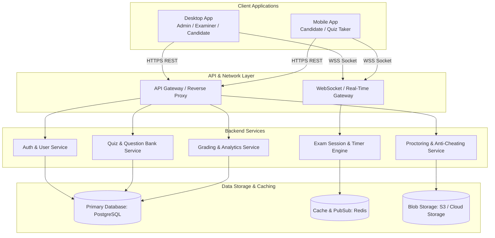

# Online Quiz System - Architecture Design

## 1. System Overview

The **Online Quiz System** is a multi-platform platform designed to deliver secure, responsive, and real-time assessments across both **Desktop** and **Mobile** environments, backed by a unified backend service.



---

## 2. Platform Requirements & Roles

### 2.1 User Roles
1. **Candidate / Student (Mobile & Desktop):**
   - Browse public quizzes or join via invite/code.
   - Timed quiz taking with offline/intermittent connectivity recovery.
   - Instant review, scorecards, leaderboards, and detailed explanations.
2. **Examiner / Instructor (Primarily Desktop):**
   - Rich quiz builder (Multiple choice, code snippet, true/false, subjective, fill-in-the-blank).
   - Question banks with tagging, difficulty levels, and automated randomization.
   - Live monitoring of active candidates (progress, live score tracker).
3. **Administrator (Desktop):**
   - Role-based access control (RBAC), user management, compliance, and audit logs.

---

## 3. Recommended Technology Stack

| Layer | Recommended Choice | Alternative Options | Rationale |
|---|---|---|---|
| **Cross-Platform Client (Desktop & Mobile)** | **Flutter (Dart)** | React Native (Mobile) + Tauri / Electron (Desktop) | Single codebase that compiles natively to Android, iOS, Windows, macOS, and Linux with 60/120fps performance and uniform UI. |
| **Backend Framework** | **Node.js (NestJS / Express)** or **Go (Gin)** / **Python (FastAPI)** | Spring Boot, ASP.NET Core | Fast asynchronous I/O, excellent WebSocket support for real-time exam countdowns and event streaming. |
| **Real-time Engine** | **Socket.IO / WebSockets** | Firebase Realtime, gRPC | Sub-second sync for live timers, answer submission sync, and proctor events. |
| **Primary Database** | **PostgreSQL** | MongoDB, MySQL | Relational integrity for user data, quiz schemas, submissions, transactions, and JSONB flexibility. |
| **Cache & Real-time State** | **Redis** | Memcached, Dragonfly | Session storage, active countdowns, leaderboard rankings (Sorted Sets), rate limiting. |
| **File / Media Storage** | **AWS S3 / Cloudflare R2 / Supabase Storage** | MinIO (Self-hosted) | Question media (diagrams, audio, code files) and optional proctor snapshots. |

---

## 4. Key Architectural Modules

### 4.1 Quiz & Question Engine
- **Question Schema:** JSON-driven flexible question types (Single Choice, Multi-Select, Numerical, Code Snippet, Matching).
- **Randomization & Shuffling:** Seeded shuffling per candidate to minimize collusion while ensuring uniform grading.
- **Auto-Grading Pipeline:** Immediate calculation for objective questions, queued asynchronous evaluation for complex submissions.

### 4.2 Real-time Exam Session & Timer Service
- **Server-Authoritative Clock:** Prevents device clock manipulation.
- **Heartbeat & Reconnection:** Automatic state recovery if network drops; local caching of answers until verified by server.
- **Anti-Cheating / Proctoring Basics:**
  - Desktop: Focus-loss / window-blur tracking, full-screen lock mode.
  - Mobile: App minimize / background detection, screen-lock alerts.

### 4.3 Analytics & Reporting
- Detailed question-wise breakdown (accuracy, average time per question).
- Score normalization, percentile calculations, and PDF certificate/report generation.

---

## 5. Proposed Project Folder Structure

```text
Online_Quiz_System/
├── apps/
│   ├── client/                  # Cross-platform Client (Flutter or React Native/Desktop)
│   │   ├── lib/
│   │   │   ├── core/            # Network, auth tokens, themes, router
│   │   │   ├── features/
│   │   │   │   ├── auth/        # Login, registration, profile
│   │   │   │   ├── quiz_taker/  # Exam view, question card, timer, review
│   │   │   │   ├── quiz_maker/  # Question builder, quiz settings (Desktop)
│   │   │   │   ├── dashboard/   # Recent tests, analytics, reports
│   │   │   └── main.dart
│   │   └── pubspec.yaml
│   └── server/                  # Backend API & WebSocket Server
│       ├── src/
│       │   ├── auth/
│       │   ├── quiz/
│       │   ├── session/
│       │   ├── analytics/
│       │   └── common/
│       └── package.json
├── docs/                        # Architecture diagrams, API specs
├── .gitignore
├── ARCHITECTURE.md
└── README.md
```
