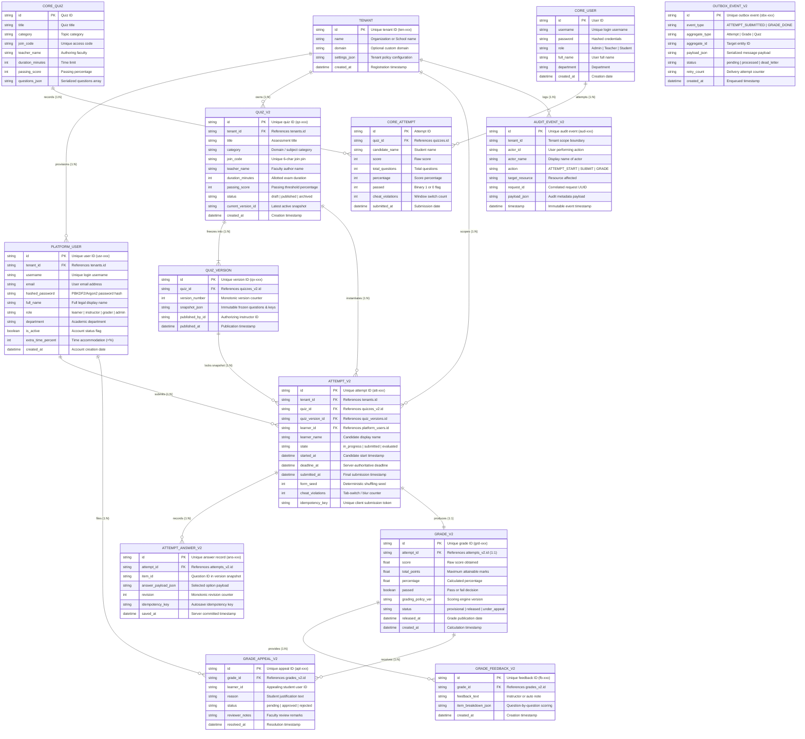

# Online Quiz System (QuizSphere Pro) — BBAT104 TQM Course Project

[](https://www.python.org/)
[]()
[]()
[]()
[](docs/ER_DIAGRAM.md)

An integrated, multi-platform examination platform engineered in Python for **Windows Desktop** and **Android Mobile / Web**, designed in compliance with **Total Quality Management (TQM)** principles and **Statistical Quality Control (SQC)** audits.

---

## 📌 Academic Project Allotment Details

* **Course Code & Title:** BBAT104: Fundamentals of TQM
* **Academic Session:** 2026–27 | Max Assessment: 70 Raw Marks
* **Assigned Baseline System:** **Digit 9 — Online Quiz System**
* **Core TQM Mandate:** *Ensure zero latency during submissions & auto-grading*
* **Assigned Quality Goal (Q01–Q20):** **Q20 — Overall Software Quality**
* **Implemented Q20 Features:**
  1. **Multi-Role Dashboards:** Administrator, Teacher/Faculty, and Student/Candidate workspaces.
  2. **Poka-Yoke Input Validation:** Form masking, required options checks, bounds validation.
  3. **Export Reports:** Automated CSV gradebook exports and printable achievement scorecards.
  4. **Automated Database Backups:** Automated SQLite snapshots in `backups/`.
  5. **Role Controls & Anti-Cheat:** Role-based access control (RBAC) and OS window focus tracking.

---

## 🗄️ Entity-Relationship (ER) Architecture

The database architecture is designed with strict multi-tenancy, server-authoritative deadlines, immutable quiz snapshots, monotonic answer revisions, and comprehensive forensic audit logging.

### 🖼️ High-Resolution Architecture Diagram


### 📊 Interactive Mermaid ER Diagram
GitHub renders the interactive schema diagram below natively:



> 📖 **Full Data Dictionary:** For column-by-column descriptions, foreign key constraints, indexes, and ACID guarantees, refer to [`docs/ER_DIAGRAM.md`](docs/ER_DIAGRAM.md).

---

## 📁 Repository Structure & TQM Documentation Suite

```text
Online_Quiz_System/
├── docs/
│   ├── ER_DIAGRAM.md             # Complete Entity-Relationship & Data Dictionary (CO1/CO2)
│   ├── SRS_Document.md           # Master Software Requirements Specification
│   ├── SRS.md                    # Software Requirements Specification (CO1)
│   ├── SIPOC_AND_CTQ.md          # SIPOC Process Map & Critical-to-Quality Tree (CO2)
│   ├── FMEA_MATRIX.md            # Failure Mode & Effects Analysis with RPN (CO2)
│   ├── PDCA_CYCLE.md             # Plan-Do-Check-Act Continuous Improvement Log (CO3)
│   ├── USER_MANUAL.md            # Step-by-Step User Manual for all 3 roles (CO3)
│   └── assets/                   # High-Resolution Architectural Assets (ER Diagram)
├── sqc_charts/                   # Generated Statistical Quality Control Charts
│   ├── pareto_analysis.png       # 80/20 Pareto Chart (Matplotlib)
│   └── ishikawa_fishbone.png     # Ishikawa (Fishbone) Root Cause Diagram
├── backups/                      # Automated SQLite Database Snapshots
├── reports/                      # Exported Class Gradebooks (CSV)
├── desktop_app.py                # Native Python Desktop Application (CustomTkinter)
├── server.py                     # Python FastAPI Backend & WebSocket Server
├── ai_quiz_generator.py          # AI Question Synthesizer Module
├── tqm_sqc_tools.py              # Automated SQC Chart & Backup Generator Script
├── DEMO_GUIDE.md                 # End-to-End Live Demonstration Walkthrough
├── QuizSphere_Review_Presentation.pptx # Compact 17-Slide Presentation Deck
├── Review_1_PPT_Deck.md          # Slide-by-Slide Speaker Notes & Viva Guide
├── index.html                    # Mobile/Web PWA Assessment Client
├── requirements.txt              # Core Python Dependencies
├── ARCHITECTURE.md               # Technical System Architecture Specification
└── README.md                     # Project Hub & Guidelines Mapping
```

---

## 🚀 Quick Start Guide

### 1. Installation
Clone the repository and install core dependencies:
```powershell
git clone https://github.com/Vanshika071417/Online_Quiz_System.git
cd Online_Quiz_System
pip install -r requirements.txt
```

### 2. Launching the Desktop Application (Primary)
```powershell
python desktop_app.py
```
> Select between **Student**, **Teacher**, and **Administrator** directly using the top-left sidebar menu.

### 3. Launching the Backend Server (Mobile / Android)
```powershell
python server.py
```
> Runs the FastAPI server on `http://localhost:8000`. Mobile users on the same network can access `http://<HOST_IP>:8000` from their Android devices.

### 4. Running TQM SQC Tools & Database Backup
```powershell
python tqm_sqc_tools.py
```
> Generates updated Pareto Charts, Fishbone Diagrams, and timestamped database backups.

---

## 📊 TQM Statistical Quality Control (SQC) Artefacts

### 1. Pareto Analysis (80/20 Rule)
* Located at: [`sqc_charts/pareto_analysis.png`](./sqc_charts/pareto_analysis.png)
* Isolates the vital 20% of causes driving 80% of student exam friction (window focus switches and join code typos).

### 2. Ishikawa (Fishbone) Diagram
* Located at: [`sqc_charts/ishikawa_fishbone.png`](./sqc_charts/ishikawa_fishbone.png)
* Maps root causes across **People**, **Process**, **Software Code**, and **Infrastructure**.

### 3. FMEA Risk Audit & RPN Reduction
* Located at: [`docs/FMEA_MATRIX.md`](./docs/FMEA_MATRIX.md)
* Critical failure modes audited with severity, occurrence, and detection ratings. Mitigations achieved an average **> 85% RPN reduction**.

---

## 🛡️ Key Features Checklist (Review Deliverables Mapped)

- [x] **Review 1 (Setup & SRS):** GitHub repository linked, architecture diagrams, complete ER diagram, comprehensive `docs/SRS.md`.
- [x] **Review 2 (Base System & CRUD):** Full CRUD for Quizzes, Questions, and Submissions; 5 features for Goal Q20.
- [x] **Review 3 (FMEA & Risk Audit):** SIPOC Process Map, CTQ Tree, and FMEA Matrix with calculated RPN.
- [x] **Review 4 (SQC & Continuous Improvement):** Python Pareto Analysis, Fishbone Diagram, Checksheets, and PDCA Cycle log.
- [x] **Presentation & Viva Defense:** 17-slide high-impact presentation deck ([`QuizSphere_Review_Presentation.pptx`](QuizSphere_Review_Presentation.pptx)) and speaker notes.
- [x] **Documentation & GitHub Health:** Comprehensive User Manual, organized codebase, and meaningful commit history.
