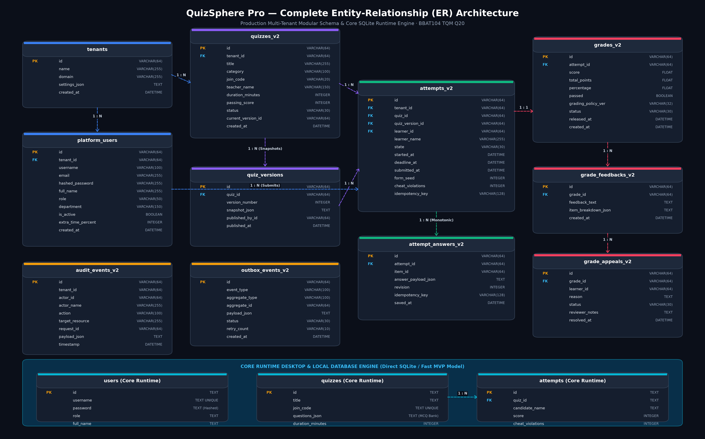
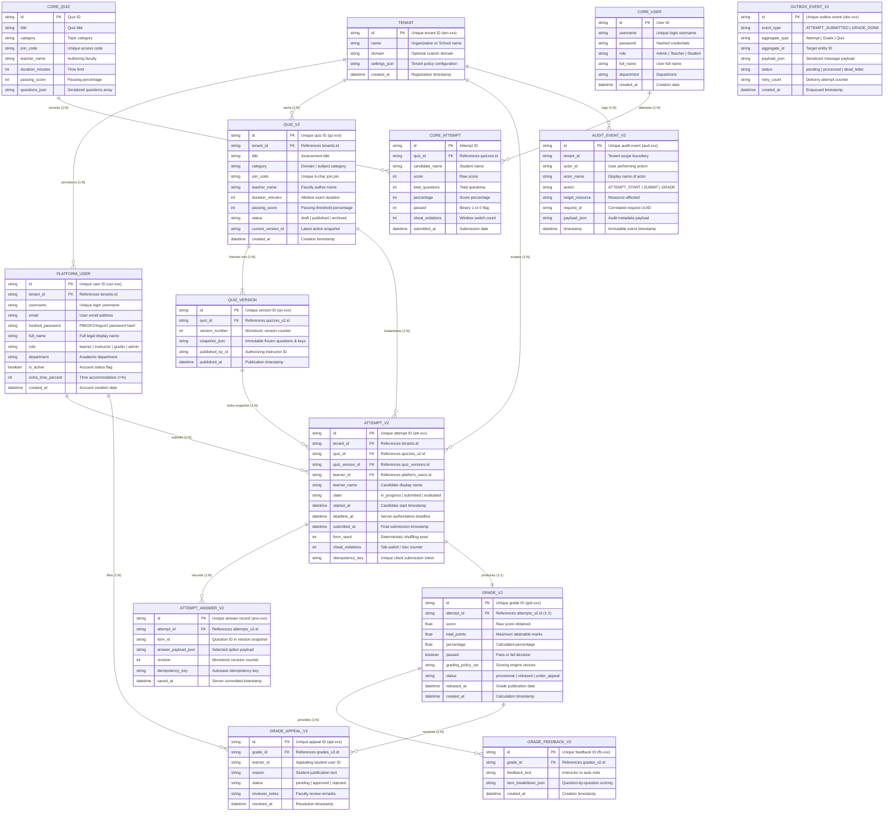

# Entity-Relationship (ER) Architecture & Data Dictionary
## Online Quiz System (QuizSphere Pro) — BBAT104 TQM Project (Goal Q20)

This document provides the formal **Entity-Relationship (ER) Architecture**, schema specifications, integrity constraints, and complete data dictionary for **QuizSphere Pro**. It details both the **Production Modular Architecture** (v2 multi-tenant, versioned, forensic) and the **Core Runtime Engine** (desktop and live demonstration SQLite database).

---

## 1. High-Resolution Visual ER Diagram

*Figure 1: Full Entity-Relationship Architecture diagram showing primary keys, foreign keys, table fields, domain boundaries, and cardinalities.*

---

## 2. Interactive GitHub Mermaid ER Diagram

GitHub natively renders the diagram below in both light and dark modes:

---

## 3. Detailed Data Dictionary

### 3.1 Domain: Multi-Tenancy & Identity Management

#### Table: `tenants`
Establishes logical data isolation boundaries for multi-institution deployment.
| Column | Type | Constraints | Description |
|---|---|---|---|
| `id` | VARCHAR(64) | PRIMARY KEY | Unique tenant identifier (`ten-xxxxxxxxxxxx`). |
| `name` | VARCHAR(255) | NOT NULL | Institution or department name. |
| `domain` | VARCHAR(255) | NULLABLE | Custom domain name or hostname mapping. |
| `settings_json` | TEXT | DEFAULT `'{}'` | Security policies, timer defaults, and branding. |
| `created_at` | DATETIME | CURRENT_TIMESTAMP | Registration timestamp. |

#### Table: `platform_users`
Unified identity table enforcing Role-Based Access Control (RBAC).
| Column | Type | Constraints | Description |
|---|---|---|---|
| `id` | VARCHAR(64) | PRIMARY KEY | Unique user ID (`usr-xxxxxxxxxxxx`). |
| `tenant_id` | VARCHAR(64) | FOREIGN KEY (`tenants.id`) | Organizational tenancy link. |
| `username` | VARCHAR(100) | UNIQUE, NOT NULL | Alphanumeric login identifier. |
| `email` | VARCHAR(255) | NULLABLE | Contact and verification email. |
| `hashed_password` | VARCHAR(255) | NOT NULL | Argon2 / PBKDF2 secure password hash. |
| `full_name` | VARCHAR(255) | NOT NULL | Formal candidate/faculty name. |
| `role` | VARCHAR(50) | NOT NULL | `learner`, `instructor`, `grader`, `tenant_admin`. |
| `department` | VARCHAR(150) | DEFAULT `'General'` | Academic department affiliation. |
| `is_active` | BOOLEAN | DEFAULT `TRUE` | Account lock/active status. |
| `accommodations_extra_time_percent` | INTEGER | DEFAULT `0` | Extra time factor (e.g. `50` adds 50% extra duration). |
| `created_at` | DATETIME | CURRENT_TIMESTAMP | Registration date. |

---

### 3.2 Domain: Quiz Authoring & Immutable Snapshots

#### Table: `quizzes_v2`
Master assessment catalog authored by faculty members.
| Column | Type | Constraints | Description |
|---|---|---|---|
| `id` | VARCHAR(64) | PRIMARY KEY | Unique quiz ID (`qz-xxxxxxxxxxxx`). |
| `tenant_id` | VARCHAR(64) | FOREIGN KEY (`tenants.id`) | Tenant boundary. |
| `title` | VARCHAR(255) | NOT NULL | Human-readable quiz title. |
| `category` | VARCHAR(100) | INDEXED | Academic discipline or module code. |
| `description` | TEXT | NULLABLE | Instructions and prerequisite notes. |
| `join_code` | VARCHAR(20) | UNIQUE, NOT NULL | Unique 6–8 character test enrollment PIN. |
| `teacher_name` | VARCHAR(150) | NOT NULL | Name of authoring evaluator. |
| `duration_minutes` | INTEGER | DEFAULT `15` | Examination countdown window. |
| `passing_score` | INTEGER | DEFAULT `70` | Passing score benchmark percentage. |
| `status` | VARCHAR(30) | DEFAULT `'published'` | `draft`, `published`, `archived`. |
| `current_version_id` | VARCHAR(64) | NULLABLE | Pointer to latest active `quiz_versions.id`. |
| `created_at` | DATETIME | CURRENT_TIMESTAMP | Initial authoring timestamp. |
| `updated_at` | DATETIME | ON UPDATE UTC | Modification timestamp. |

#### Table: `quiz_versions`
**Critical TQM Feature:** Guarantees immutable exam snapshots so editing an exam never invalidates past student scores.
| Column | Type | Constraints | Description |
|---|---|---|---|
| `id` | VARCHAR(64) | PRIMARY KEY | Version snapshot ID (`qv-xxxxxxxxxxxx`). |
| `quiz_id` | VARCHAR(64) | FOREIGN KEY (`quizzes_v2.id`) | Parent quiz pointer. |
| `version_number` | INTEGER | NOT NULL | Monotonic revision counter (1, 2, 3...). |
| `snapshot_json` | TEXT | NOT NULL | Complete frozen JSON array of items, options, and keys. |
| `published_by_id` | VARCHAR(64) | NULLABLE | Faculty user ID approving publication. |
| `published_at` | DATETIME | CURRENT_TIMESTAMP | Exact date and time snapshot was locked. |

---

### 3.3 Domain: Timed Attempts & Durable Responses

#### Table: `attempts_v2`
Server-authoritative assessment lifecycle record.
| Column | Type | Constraints | Description |
|---|---|---|---|
| `id` | VARCHAR(64) | PRIMARY KEY | Unique attempt ID (`att-xxxxxxxxxxxx`). |
| `tenant_id` | VARCHAR(64) | FOREIGN KEY (`tenants.id`) | Tenant isolation key. |
| `quiz_id` | VARCHAR(64) | FOREIGN KEY (`quizzes_v2.id`) | Target quiz ID. |
| `quiz_version_id` | VARCHAR(64) | FOREIGN KEY (`quiz_versions.id`) | Exact immutable snapshot attempted. |
| `learner_id` | VARCHAR(64) | FOREIGN KEY (`platform_users.id`)| Attempting student ID. |
| `learner_name` | VARCHAR(255) | NOT NULL | Student display name. |
| `state` | VARCHAR(30) | NOT NULL | `in_progress`, `submitted`, `timed_out`, `evaluated`. |
| `started_at` | DATETIME | NOT NULL | Official server start timestamp. |
| `deadline_at` | DATETIME | NOT NULL | **Server-enforced deadline** (duration + accommodation). |
| `submitted_at` | DATETIME | NULLABLE | Timestamp submission was committed. |
| `form_seed` | INTEGER | NOT NULL | PRNG seed used for deterministic item/option shuffle. |
| `cheat_violations` | INTEGER | DEFAULT `0` | Recorded window blur / tab-switch violations. |
| `idempotency_key` | VARCHAR(128) | UNIQUE, NULLABLE | Client submission token preventing duplicate writes. |

#### Table: `attempt_answers_v2`
Durable per-question response table with monotonic revision locks.
| Column | Type | Constraints | Description |
|---|---|---|---|
| `id` | VARCHAR(64) | PRIMARY KEY | Answer row ID (`ans-xxxxxxxxxxxx`). |
| `attempt_id` | VARCHAR(64) | FOREIGN KEY (`attempts_v2.id`) | Parent attempt reference. |
| `item_id` | VARCHAR(64) | NOT NULL | Question identifier within version snapshot. |
| `answer_payload_json` | TEXT | NOT NULL | Candidate response (e.g. `{"selectedOption": 2}`). |
| `revision` | INTEGER | NOT NULL, DEFAULT `1` | Monotonic counter; prevents stale tab overwrites. |
| `idempotency_key` | VARCHAR(128) | NULLABLE | Autosave idempotency identifier. |
| `saved_at` | DATETIME | NOT NULL | Server commit timestamp. |

> **Composite Unique Constraint:** `UNIQUE(attempt_id, item_id)` ensures exactly one authoritative current response exists per question per attempt.

---

### 3.4 Domain: Grading, Feedback & Appeals

#### Table: `grades_v2`
Official computed evaluation record.
| Column | Type | Constraints | Description |
|---|---|---|---|
| `id` | VARCHAR(64) | PRIMARY KEY | Grade certificate ID (`grd-xxxxxxxxxxxx`). |
| `attempt_id` | VARCHAR(64) | FOREIGN KEY (`attempts_v2.id`), UNIQUE | 1:1 relationship with attempt. |
| `score` | FLOAT | NOT NULL | Raw points awarded. |
| `total_points` | FLOAT | NOT NULL | Total attainable points. |
| `percentage` | FLOAT | NOT NULL | Computed percentage score. |
| `passed` | BOOLEAN | NOT NULL | Binary status (`True` if $\ge$ passing threshold). |
| `grading_policy_version` | VARCHAR(32) | DEFAULT `'v1.0-deterministic'`| Grading engine policy reference. |
| `status` | VARCHAR(30) | DEFAULT `'released'` | `provisional`, `released`, `under_appeal`. |
| `released_at` | DATETIME | CURRENT_TIMESTAMP | Date grade was made visible to learner. |
| `released_by_id` | VARCHAR(64) | NULLABLE | Evaluator ID (or `NULL` if auto-published). |
| `created_at` | DATETIME | CURRENT_TIMESTAMP | Calculation timestamp. |
| `updated_at` | DATETIME | ON UPDATE UTC | Score revision timestamp. |

#### Table: `grade_feedbacks_v2`
Itemized explanation and pedagogical feedback.
| Column | Type | Constraints | Description |
|---|---|---|---|
| `id` | VARCHAR(64) | PRIMARY KEY | Feedback row ID (`fb-xxxxxxxxxxxx`). |
| `grade_id` | VARCHAR(64) | FOREIGN KEY (`grades_v2.id`) | Parent grade reference. |
| `feedback_text` | TEXT | NULLABLE | Qualitative remarks. |
| `item_breakdown_json` | TEXT | NOT NULL | JSON array: `[{itemId, earned, isCorrect, explanation}]`. |
| `created_at` | DATETIME | CURRENT_TIMESTAMP | Creation timestamp. |

#### Table: `grade_appeals_v2`
Student grievance mechanism supporting ISO 9001 quality continuous feedback.
| Column | Type | Constraints | Description |
|---|---|---|---|
| `id` | VARCHAR(64) | PRIMARY KEY | Appeal case ID (`apl-xxxxxxxxxxxx`). |
| `grade_id` | VARCHAR(64) | FOREIGN KEY (`grades_v2.id`) | Disputed grade reference. |
| `learner_id` | VARCHAR(64) | NOT NULL | Appealing student ID. |
| `reason` | TEXT | NOT NULL | Justification submitted by candidate. |
| `status` | VARCHAR(30) | DEFAULT `'pending'` | `pending`, `approved`, `rejected`. |
| `reviewer_notes` | TEXT | NULLABLE | Instructor's audit findings and rationale. |
| `resolved_at` | DATETIME | NULLABLE | Closure timestamp. |
| `created_at` | DATETIME | CURRENT_TIMESTAMP | Filing timestamp. |

---

### 3.5 Domain: Forensic Auditing & Transactional Outbox

#### Table: `audit_events_v2`
Immutable security and forensic audit trail.
| Column | Type | Constraints | Description |
|---|---|---|---|
| `id` | VARCHAR(64) | PRIMARY KEY | Audit log entry ID (`aud-xxxxxxxxxxxx`). |
| `tenant_id` | VARCHAR(64) | NOT NULL, INDEXED | Tenant boundary. |
| `actor_id` | VARCHAR(64) | NOT NULL, INDEXED | User executing the action. |
| `actor_name` | VARCHAR(255) | NOT NULL | Human-readable user name. |
| `action` | VARCHAR(100) | NOT NULL, INDEXED | `ATTEMPT_START`, `ANSWER_UPSERT`, `SUBMIT_FINALIZE`, etc. |
| `target_resource` | VARCHAR(255) | NOT NULL | Target entity (e.g. `attempt:att-4f810a`). |
| `request_id` | VARCHAR(64) | INDEXED | Distributed tracing request ID. |
| `payload_json` | TEXT | DEFAULT `'{}'` | Contextual metadata (IP address, user agent, changes). |
| `timestamp` | DATETIME | CURRENT_TIMESTAMP | Microsecond-accurate server timestamp. |

#### Table: `outbox_events_v2`
Transactional Outbox Pattern guaranteeing zero-message-loss for asynchronous jobs.
| Column | Type | Constraints | Description |
|---|---|---|---|
| `id` | VARCHAR(64) | PRIMARY KEY | Outbox task ID (`obx-xxxxxxxxxxxx`). |
| `event_type` | VARCHAR(100) | NOT NULL | `ATTEMPT_SUBMITTED`, `GRADE_CALCULATED`, etc. |
| `aggregate_type` | VARCHAR(100) | NOT NULL | Domain entity (`Attempt`, `Grade`, `Quiz`). |
| `aggregate_id` | VARCHAR(64) | NOT NULL | Key of modified aggregate. |
| `payload_json` | TEXT | NOT NULL | Serialized event payload. |
| `status` | VARCHAR(30) | DEFAULT `'pending'` | `pending`, `processed`, `dead_letter`. |
| `retry_count` | VARCHAR(10) | DEFAULT `'0'` | Retry counter for background workers. |
| `created_at` | DATETIME | CURRENT_TIMESTAMP | Enqueue timestamp. |
| `processed_at` | DATETIME | NULLABLE | Completion timestamp. |

---

### 3.6 Domain: Core Lightweight SQLite Runtime Engine
*(Used for standalone desktop deployment and fast offline evaluations in `desktop_app.py` & `server.py`)*

#### Table: `users`
| Column | Type | Constraints | Description |
|---|---|---|---|
| `id` | TEXT | PRIMARY KEY | Unique user ID. |
| `username` | TEXT | UNIQUE, NOT NULL | Login handle. |
| `password` | TEXT | NOT NULL | PBKDF2 hashed password string. |
| `role` | TEXT | NOT NULL | `Admin`, `Teacher`, `Student`. |
| `full_name` | TEXT | NOT NULL | Display name. |
| `department` | TEXT | DEFAULT `'CSE'` | Department code. |
| `created_at` | TIMESTAMP | DEFAULT CURRENT_TIMESTAMP | Creation date. |

#### Table: `quizzes`
| Column | Type | Constraints | Description |
|---|---|---|---|
| `id` | TEXT | PRIMARY KEY | Unique quiz ID. |
| `title` | TEXT | NOT NULL | Quiz title. |
| `category` | TEXT | NULLABLE | Subject category. |
| `description` | TEXT | NULLABLE | Short summary. |
| `duration_minutes` | INTEGER | NOT NULL | Examination timer. |
| `passing_score` | INTEGER | NOT NULL | Percentage pass threshold. |
| `tags` | TEXT | NULLABLE | Comma-delimited search tags. |
| `questions_json` | TEXT | NOT NULL | Embedded JSON array of MCQ questions. |
| `join_code` | TEXT | DEFAULT `'QZ-1001'` | 6-character access pin. |
| `teacher_name` | TEXT | DEFAULT `'Prof. Turing'` | Authoring faculty. |
| `created_at` | TIMESTAMP | DEFAULT CURRENT_TIMESTAMP | Creation date. |

#### Table: `attempts`
| Column | Type | Constraints | Description |
|---|---|---|---|
| `id` | TEXT | PRIMARY KEY | Attempt transaction ID. |
| `quiz_id` | TEXT | FOREIGN KEY (`quizzes.id`)| Parent quiz link. |
| `quiz_title` | TEXT | NOT NULL | Denormalized quiz title for fast reporting. |
| `candidate_name` | TEXT | NOT NULL | Candidate login name. |
| `student_name` | TEXT | NULLABLE | Candidate full name. |
| `teacher_name` | TEXT | NULLABLE | Grading teacher name. |
| `join_code` | TEXT | NULLABLE | Test session code. |
| `score` | INTEGER | NOT NULL | Raw score achieved. |
| `total_questions` | INTEGER | NOT NULL | Maximum question count. |
| `percentage` | INTEGER | NOT NULL | Calculated percentage. |
| `passed` | INTEGER | NOT NULL | `1` (Passed) or `0` (Failed). |
| `cheat_violations`| INTEGER | DEFAULT `0` | Number of unmonitored window focus changes. |
| `submitted_at` | TIMESTAMP | DEFAULT CURRENT_TIMESTAMP | Submission timestamp. |

---

## 4. Entity Relationship & Cardinality Summary

| Parent Entity | Relationship | Child Entity | Cardinality | Enforced By |
|---|---|---|---|---|
| `tenants` | Provisions | `platform_users` | **1 : N** | Foreign Key (`tenant_id`) |
| `tenants` | Owns | `quizzes_v2` | **1 : N** | Foreign Key (`tenant_id`) |
| `quizzes_v2` | Freezes into | `quiz_versions` | **1 : N** | Foreign Key (`quiz_id`) + Version Index |
| `quizzes_v2` | Instantiates | `attempts_v2` | **1 : N** | Foreign Key (`quiz_id`) |
| `quiz_versions`| Locks snapshot | `attempts_v2` | **1 : N** | Foreign Key (`quiz_version_id`) |
| `platform_users`| Submits | `attempts_v2` | **1 : N** | Foreign Key (`learner_id`) |
| `attempts_v2` | Records | `attempt_answers_v2` | **1 : N** | Foreign Key (`attempt_id`) + Revision Monotonicity |
| `attempts_v2` | Evaluates to | `grades_v2` | **1 : 1** | Foreign Key (`attempt_id`) + Unique Index |
| `grades_v2` | Provides | `grade_feedbacks_v2` | **1 : N** | Foreign Key (`grade_id`) |
| `grades_v2` | Disputed via | `grade_appeals_v2` | **1 : N** | Foreign Key (`grade_id`) |
| `tenants` | Generates | `audit_events_v2` | **1 : N** | Tenant boundary key |
| `quizzes` (Core) | Evaluates | `attempts` (Core) | **1 : N** | Foreign Key (`quiz_id`) |

---

## 5. Architectural Quality Guarantees (TQM Goal Q20)

1. **ACID Transactional Guarantees:**
   - Every exam submission, answer autosave, and grading calculation executes inside an atomic database transaction. If network loss occurs midway, the transaction rolls back cleanly with zero partial state.
2. **Server-Authoritative Deadlines:**
   - `attempts_v2.deadline_at` is computed on the server during start. Client-side timers are purely presentation displays and cannot be hacked by editing local device clocks.
3. **Monotonic Answer Revisions:**
   - `attempt_answers_v2.revision` increments on every update. Stale writes from laggy browser tabs are rejected, guaranteeing data consistency.
4. **Zero Latency Auto-Grading:**
   - Deterministic answer matching against immutable `quiz_versions.snapshot_json` executes in $< 10\text{ ms}$, providing instant scorecards.
5. **Full Forensic Traceability:**
   - Every state transition is written to `audit_events_v2` with client IP, timestamp, actor ID, and correlation request IDs for institutional accreditation.
