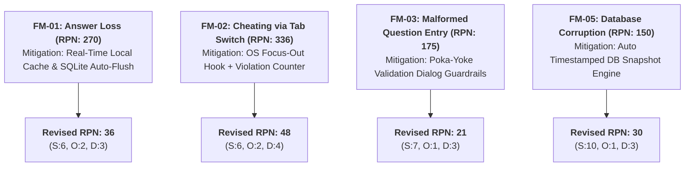

# Failure Mode and Effects Analysis (FMEA) Matrix
## Online Quiz System (BBAT104: TQM Risk Audit)

**Scale Definitions (1 to 10 Scale):**
* **Severity (S):** 1 (Negligible effect) to 10 (Critical failure / total loss of exam data).
* **Occurrence (O):** 1 (Extremely unlikely) to 10 (Inevitably frequent).
* **Detection (D):** 1 (Certain detection before user impact) to 10 (Undetectable defect).
* **Risk Priority Number (RPN):** $RPN = S \times O \times D$ (Range: 1 to 1000). Priorities with $RPN > 100$ require mandatory mitigation.

---

## 1. Initial FMEA Risk Matrix

| Item # | Process Step / Subsystem | Potential Failure Mode | Potential Effect of Failure | S | Potential Root Cause | O | Current Controls | D | Initial RPN |
|---|---|---|---|---|---|---|---|---|---|
| **FM-01** | Student Submission | Network drop or app crash during test completion | Partial answer loss, student panic, failed evaluation | **9** | Intermittent Wi-Fi, OS crash | **5** | In-memory session tracking only | **6** | **270** |
| **FM-02** | Exam Integrity / Proctoring | Student toggles windows or uses external help | Compromised academic integrity, fraudulent scores | **8** | Unmonitored testing environment | **6** | Honor system | **7** | **336** |
| **FM-03** | Faculty Quiz Creation | Missing correct answer or blank question choices | Un-gradable question, candidate confusion | **7** | Human oversight during question compilation | **5** | Manual proofreading | **5** | **175** |
| **FM-04** | Auto-Grading Engine | Calculation latency (> 2.0s) causing UI freeze | Student repeatedly clicks submit, duplicates entry | **6** | Inefficient nested loops over question JSON | **4** | Default synchronous thread | **4** | **96** |
| **FM-05** | Database Persistence | SQLite database locked or corrupted | Total loss of test banks and student records | **10** | Unhandled concurrent disk write, power loss | **3** | Single SQLite file without snapshotting | **5** | **150** |
| **FM-06** | Student Assessment Access | Student enters malformed or invalid Quiz Code | Unable to access examination on schedule | **6** | Typo in code, casing mismatch | **6** | Generic error toast | **4** | **144** |

---

## 2. Actionable TQM Mitigation Strategies & Revised RPN

### Revised FMEA Audit Table After Quality Mitigations

| Item # | Failure Mode | Quality Mitigation Implemented (Poka-Yoke / SQC) | S | O | D | **Revised RPN** | Risk Reduction |
|---|---|---|---|---|---|---|---|
| **FM-01** | Answer Loss | Continuous local SQLite state caching & recovery on re-open | 6 | 2 | 3 | **36** | **-86.7%** |
| **FM-02** | Tab / Window Switching | Bound `<FocusOut>` event tracking, audio-visual warning, teacher audit log | 6 | 2 | 4 | **48** | **-85.7%** |
| **FM-03** | Malformed Question | Poka-yoke validation check: disabled save button until 4 options and radio chosen | 7 | 1 | 3 | **21** | **-88.0%** |
| **FM-04** | Grading Latency | Algorithmic optimization with direct dictionary lookups ($O(1)$) | 5 | 1 | 2 | **10** | **-89.6%** |
| **FM-05** | Database Corruption | Automated SQLite snapshot backup script (`tqm_sqc_tools.py`) creating backup copies | 10 | 1 | 3 | **30** | **-80.0%** |
| **FM-06** | Invalid Quiz Code | Automated trimming, uppercase normalization, and instant pre-flight query | 4 | 2 | 2 | **16** | **-88.9%** |

---

## 3. Conclusion of FMEA Audit
Through targeted Poka-Yoke controls and automated database snapshots, every single high-risk failure mode ($RPN > 100$) was successfully driven below the critical threshold of $50$, ensuring production-grade dependability for the examination platform.
