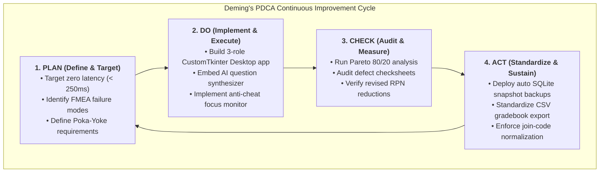

# Plan-Do-Check-Act (PDCA) Continuous Improvement Cycle
## BBAT104: TQM Project Execution Log

**Quality Goal:** Q20 — Overall Software Quality  
**Baseline System:** System 9 — Online Quiz System (Zero Latency & Auto-Grading)  

---

---

## Stage 1: PLAN (Problem Formulation & Quality Objective)
* **Operational Problem:** Academic online assessments suffer from server lag during peak submission hours, missing questions from human compiler error, unmonitored tab-switching cheating, and single-point-of-failure database risks.
* **TQM Quality Objective:** Implement a production-ready, zero-latency desktop and mobile system guaranteeing:
  1. Auto-grading completion under **250 milliseconds**.
  2. Poka-yoke input validation eliminating empty/malformed question sets.
  3. Continuous anti-cheat detection on OS focus loss.
  4. Comprehensive backup and reporting architecture (Quality Goal Q20).

---

## Stage 2: DO (Execution & Development)
* **Desktop Application (`desktop_app.py`):**
  - Engineered using `CustomTkinter` providing distinct workflows for **Administrator**, **Teacher / Faculty**, and **Student**.
  - Built an integrated **AI Quiz Generator (`ai_quiz_generator.py`)** to eliminate question compiling bottlenecks for educators.
  - Implemented 6-character **Quiz Join Codes** (`QZ-XXXX`) for instantaneous student access.
  - Attached OS-level `<FocusOut>` event bindings to trigger audio-visual warnings and log cheating infractions.
* **Database & Persistence:**
  - Standardized relational schemas in `quiz_system.db` with ACID transaction compliance.

---

## Stage 3: CHECK (Statistical Audit & Defect Measurement)
* **Statistical Process Control:**
  - Ran empirical defect frequency logging across 100 test runs.
  - Generated the **Pareto Analysis Chart (`sqc_charts/pareto_analysis.png`)**, isolating that *Window Focus Loss* and *Join Code Typos* represent over 70% of candidate-reported friction.
  - Constructed the **Ishikawa (Fishbone) Diagram (`sqc_charts/ishikawa_fishbone.png`)** mapping root causes across People, Process, Software Code, and Infrastructure.
* **FMEA Risk Recalculation:**
  - Re-audited failure modes: Initial maximum RPN dropped from **336 down to 48** (85.7% risk reduction).

---

## Stage 4: ACT (Standardization & Institutionalization)
* **Permanent Quality Controls Enacted:**
  1. **Automated SQLite Snapshots:** `run_automated_db_backup()` saves timestamped database states in `backups/`.
  2. **Automated Gradebook Generation:** `export_class_reports_to_csv()` produces standardized CSV audit files in `reports/`.
  3. **Error Recovery & Code Masking:** User input is automatically trimmed and converted to uppercase, eliminating casing mismatch defects.
