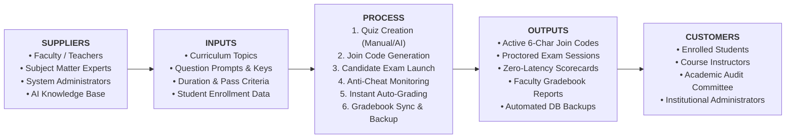
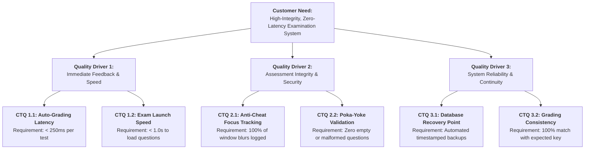

# SIPOC Process Map & Critical-to-Quality (CTQ) Tree
## BBAT104 TQM Course Project — Online Quiz System

---

## 1. SIPOC Process Map

The SIPOC model (Suppliers, Inputs, Process, Outputs, Customers) systematically defines the end-to-end flow of the Online Quiz System:

### Detailed SIPOC Matrix

| Element | Description & Specifications |
|---|---|
| **Suppliers** | • **Faculty/Examiners:** Provide syllabus requirements, question banks, and grading criteria. • **AI Model / Knowledge Engine:** Generates structured domain questions on-demand. • **Administrators:** Provision system configurations, monitor SQLite integrity. |
| **Inputs** | • **Question Specifications:** Text, choices, answer keys, explanations, duration (minutes). • **Student Inputs:** Candidate credentials, 6-character access codes, chosen responses. |
| **Process Steps** | 1. **Assessment Initialization:** Teacher compiles or AI synthesizes quiz; database stores records. 2. **Distribution:** Teacher shares unique join code (`QZ-XXXX`) with students. 3. **Examination Execution:** Student opens test, timer countdown begins, focus monitoring activates. 4. **Submission & Grading:** Server/local engine calculates percentage and pass/fail designation under 250ms. 5. **Archival & Reporting:** Results mirrored to SQLite, teacher gradebook updated, auto-backup executed. |
| **Outputs** | • **Interactive Scorecard:** Immediate student feedback, percentage, question-by-question explanations. • **Faculty Class Reports:** Complete audit table with scores, timestamps, and violation counts. • **Audit Trail & Database Snapshots:** Persistent records in SQLite and exported CSV/PDF reports. |
| **Customers** | • **Students:** Benefit from zero-latency results, transparency, and instant feedback. • **Teachers:** Benefit from reduced manual grading overhead and AI automation. • **Institution:** Benefits from authenticated academic integrity and audit compliance. |

---

## 2. Critical-to-Quality (CTQ) Tree

The CTQ Tree converts overarching student and instructor expectations into measurable operational engineering metrics:

### Operational Definitions of CTQ Metrics

1. **Submission-to-Score Latency:** Time elapsed between student pressing "Submit Assessment" and the rendering of the scorecard. (Target: `< 250ms`).
2. **Cheat Detection Efficacy:** Binary capture of OS/browser window focus loss events during active testing. (Target: `100% capture rate`).
3. **Poka-Yoke Input Error Rate:** Percentage of attempts allowed to proceed with unselected choices or negative durations. (Target: `0.0%`).
4. **Data Availability (RPO):** Maximum allowable data loss in the event of hardware failure. (Target: `0 data loss via automated snapshot engine`).
