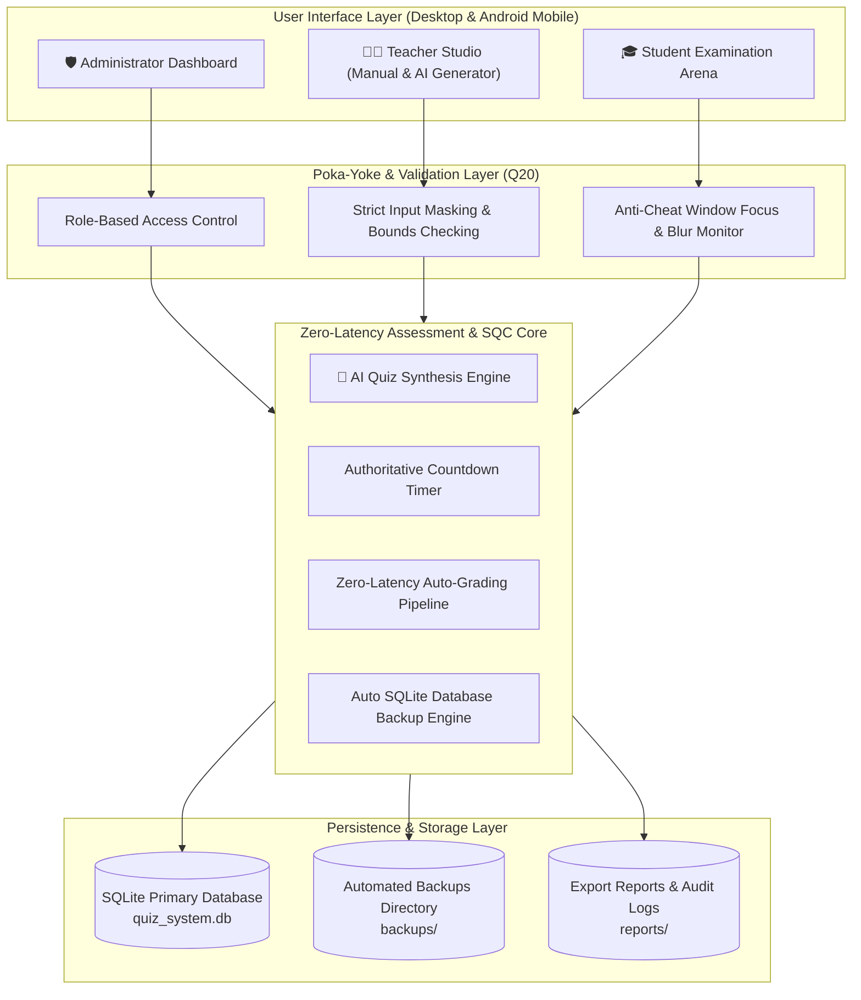

# Software Requirements Specification (SRS)
## Online Quiz System (BBAT104: Fundamentals of TQM)

**Course:** BBAT104: Fundamentals of TQM  
**Project Topic:** Baseline System 9 — Online Quiz System  
**Core TQM Target:** Ensure Zero Latency during Submissions & Auto-Grading  
**Assigned Quality Goal:** Q20 — Overall Software Quality (Balanced Mix of Dashboards, Validation, Export Reports, Backups, and Role Controls)  
**Academic Session:** 2026–27  

---

## 1. Introduction & Executive Summary

### 1.1 Purpose
This document establishes the Software Requirements Specification (SRS) for the **Online Quiz System**, an integrated assessment and examination platform engineered to eliminate latency, ensure zero-defect automated grading, and enforce stringent proctoring safeguards. It embeds Total Quality Management (TQM) principles directly into the software lifecycle, combining statistical process controls, poka-yoke (mistake-proofing), and comprehensive fail-safes.

### 1.2 Scope & Quality Objectives
The system serves three primary user cohorts:
1. **Administrators:** Comprehensive system auditing, database integrity checks, user governance, and platform-wide telemetry.
2. **Teachers & Faculty:** Automated curriculum quiz generation via artificial intelligence (AI), manual question bank crafting, unique 6-character access codes, and live student scorebook auditing.
3. **Students / Candidates:** Latency-free test environment, real-time authoritative countdown, active window focus monitoring (anti-cheat), and immediate scorecard delivery.

---

## 2. System Architecture & Flowchart

---

## 3. Critical-to-Quality (CTQ) Parameters

| CTQ Parameter | Quality Dimension | Operational Metric | Target Specification |
|---|---|---|---|
| **Submission Latency** | Performance | Auto-grading turnaround time per candidate submission | < 250 milliseconds |
| **Grading Accuracy** | Defect Prevention | Scoring consistency between expected key and calculated score | 100.0% (Zero Defect) |
| **Anti-Cheat Coverage** | Security | Focus loss detection and logging frequency | 100% of window/tab switches logged |
| **Data Integrity** | Reliability | Recovery Point Objective (RPO) via automated DB backup | Hourly auto-snapshots & on-demand backup |
| **Poka-Yoke Usability** | Usability & Robustness | Prevention of empty submissions, out-of-bounds options, duplicate codes | 0 unhandled application exceptions |

---

## 4. Functional Requirements Matrix (Q20 Quality Goal)

### 4.1 Requirement 1: Multi-Role Dashboards (Admin, Teacher, Student)
* **FR-1.1:** System must maintain distinct dashboards for Admin, Teacher, and Student with separated workspaces.
* **FR-1.2:** Admin dashboard must visualize total assessments, aggregate attempts, average platform pass rate, and global activity audit trails.
* **FR-1.3:** Teacher dashboard must provide active question bank lists, student join codes, and individual student attempt metrics.
* **FR-1.4:** Student dashboard must provide direct code entry, assessment cards, and past performance reviews.

### 4.2 Requirement 2: Strict Input Validation (Poka-Yoke Error Prevention)
* **FR-2.1:** Quiz creation must prevent empty question prompts, missing choices, or unselected correct options.
* **FR-2.2:** Duration and passing score fields must strictly accept positive integer values within safe bounds (1–180 mins, 1–100%).
* **FR-2.3:** Quiz Join Codes must be normalized, trimmed, and validated against SQL uniqueness constraints.

### 4.3 Requirement 3: AI-Powered Question Bank Generator
* **FR-3.1:** Faculty can input any syllabus topic and select difficulty level (*Beginner, Medium, Advanced*) and question quantity.
* **FR-3.2:** The generation module must output syntactically verified multiple-choice questions with 4 options, a deterministic answer key, and an explanation.

### 4.4 Requirement 4: Automated Gradebook & Export Reports
* **FR-4.1:** Faculty must have one-click export capability to generate structured CSV and printable examination summaries.
* **FR-4.2:** Every student submission must generate an instant performance scorecard with pass/fail designation and detailed answer key feedback.

### 4.5 Requirement 5: Automated Database Backups & Error Recovery
* **FR-5.1:** The system must incorporate a dedicated backup utility that creates timestamped copies of `quiz_system.db` in a protected `backups/` directory.
* **FR-5.2:** Faculty and Admins can trigger manual backups prior to major test administrations.

---

## 5. Non-Functional Requirements

1. **Performance:** Submissions must be graded and saved in local SQLite storage within a quarter of a second, satisfying the baseline project mandate.
2. **Reliability & Fault Tolerance:** Database transactions must be ACID-compliant; unexpected process interruptions must not corrupt active assessments.
3. **Usability:** Dark-themed UI with high contrast, legible typography, visual status chips, and intuitive button hierarchies.
4. **Portability:** Desktop application must run natively across Windows environments without requiring cloud connectivity. Mobile client must be fully responsive across Android viewports.
